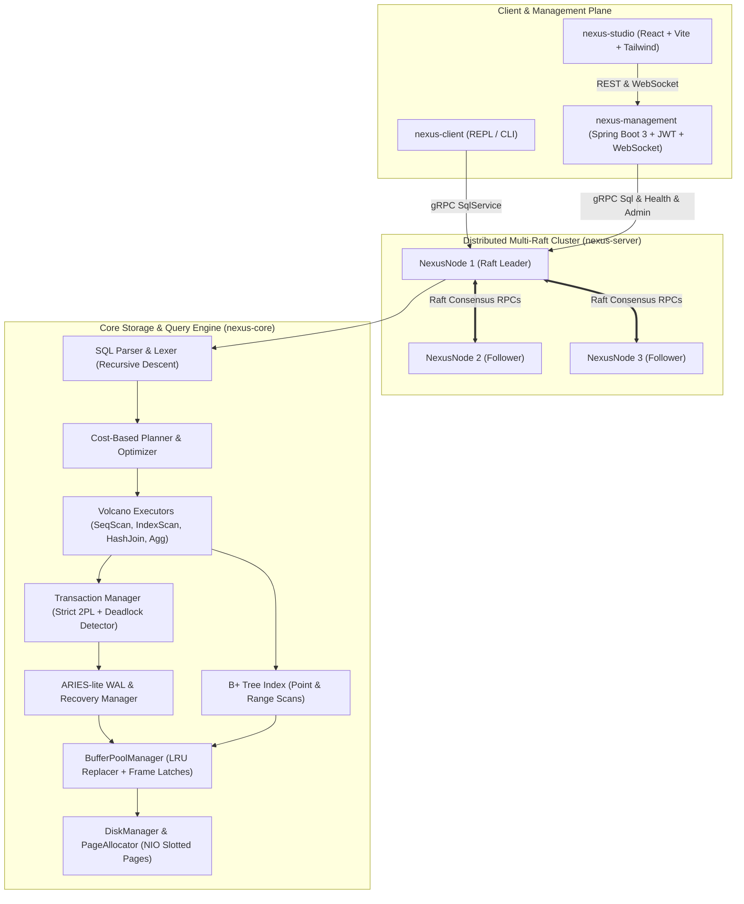

# NexusDB: Distributed Relational Database Engine

[](https://github.com/krithik9806/NexusDB/actions)
[](https://opensource.org/licenses/MIT)
[](https://openjdk.org/projects/jdk/21/)
[](https://github.com/krithik9806/NexusDB/releases/tag/v1.0.0)

**NexusDB** is a disk-backed, ACID-compliant relational and distributed database engine built in Java 21. It implements a slotted page storage engine, LRU buffer pool management, B+ Tree indexing, Volcano query execution, cost-based planning, ARIES-lite write-ahead logging (WAL) with fuzzy checkpoints, Strict Two-Phase Locking (2PL) with deadlock detection, Multi-Raft quorum consensus replication, distributed sharding with scatter-gather routing, a secured Spring Boot control plane, and a modern dark-first React/Tailwind Studio console.

---

## Architecture Overview



---

## Key Subsystems

### 1. Storage Engine (`nexus-core`)
- **Slotted Page Format**: Configurable 4 KB page size. Header with Page LSN, slot count, free space pointer, and compact slot array. Deletion dynamically frees space; compaction preserves slot IDs and eliminates fragmentation.
- **Buffer Pool Manager**: Configurable frame pool (e.g. 16,384 pages = 64 MB) using LRU replacement. Individual frame read/write latches, pin counts, dirty page tracking, and strict write-ahead logging enforcement prior to eviction.
- **Disk Manager**: Thread-safe Java NIO `FileChannel` positional I/O with page-0 header validation (magic `0x4E455855`, version `1`).
- **B+ Tree Index**: Support for unique primary key and non-unique secondary indexes stored directly in buffer pool pages. Handles leaf and internal node splits, borrower/merge rebalancing, root shrinking, point search, and bi-directional leaf sibling range scans.

### 2. SQL Parser & Query Engine (`nexus-core`)
- **Lexer & Parser**: Recursive-descent parser producing immutable AST record structures for DDL (`CREATE TABLE`, `DROP TABLE`, `CREATE INDEX`, `DROP INDEX`) and DML (`SELECT`, `INSERT`, `UPDATE`, `DELETE`, `BEGIN`, `COMMIT`, `ROLLBACK`, `EXPLAIN`).
- **Cost-Based Optimizer**: Table and index cardinality estimation, filter pushdown, index selection over sequential scan, and hash join build/probe side selection.
- **Volcano Execution**: Pipelined iterator model (`init()`, `next()`, `close()`) supporting `SeqScan`, `IndexScan`, `Filter`, `Projection`, `HashJoin`, `NestedLoopJoin`, `Aggregate` (`COUNT`, `SUM`, `AVG`, `MIN`, `MAX`, `GROUP BY`, `HAVING`), `Sort`, and `Limit`.

### 3. Durability & Concurrency (`nexus-core`)
- **ARIES-Lite Recovery**: Steal/No-Force buffer management policy. Write-ahead logging with LSN assignment, group-commit friendly flush, fuzzy checkpoints with Dirty Page Table (DPT) and Active Transaction Table (ATT). Three-pass recovery (Analysis, Redo history, and Undo loser transactions with CLRs).
- **Strict 2PL & Concurrency**: Shared (`S`) and Exclusive (`X`) lock granularity on tables and individual row `RecordId`s held until commit or rollback.
- **Deadlock Detection**: Background cycle detector inspecting the waits-for dependency graph and automatically aborting youngest transactions with descriptive errors.

### 4. Distributed Consensus & Sharding (`nexus-distributed`, `nexus-server`)
- **Raft Consensus Engine**: Deterministic state machine with term management, randomized election timeouts, log replication, quorum commit advancement, and log catchup.
- **Cluster Node Server**: High-performance gRPC server hosting `SqlService`, `HealthService`, `RaftService`, and `AdminService`.
- **Failure Detector & Fault Injector**: Heartbeat failure detector, peer replication lag monitoring, and transport-level fault injection (`DROP_TRAFFIC`, `ADD_LATENCY`, `CLEAR_FAULTS`).
- **Multi-Raft Sharding & Router**: Range and hash sharding strategies across independent Raft groups. `ShardRouter` coordinates single-key routing, scatter-gather queries with distributed `ORDER BY`, `LIMIT`, and aggregate merging, rejecting unsupported cross-shard transactions.

### 5. Control Plane & Studio (`nexus-management`, `nexus-studio`)
- **Management Backend**: Spring Boot 3 control plane with stateless HMAC-SHA256 JWT authentication, BCrypt password hashing, and role-based access control (`ADMIN`, `DEVELOPER`, `VIEWER`).
- **Observability**: Prometheus metrics export (`/actuator/prometheus`), in-memory ring-buffer time series, persistent query history, and security audit log.
- **WebSocket Streaming**: Real-time cluster state streaming over `/ws/cluster`.
- **NexusDB Studio**: Dark-first React 18, TypeScript, and Tailwind console with interactive SQL editor, schema explorer, query execution visualizer, live cluster monitor, and admin chaos simulator.

---

## Quick Start & Local Execution

### Prerequisites
- **Java 21+** (e.g., OpenJDK 21 or Eclipse Temurin)
- **Maven 3.9+**
- **Node.js 20+** (for NexusDB Studio)
- **Docker & Docker Compose** (optional, for containerized multi-node cluster)

### 1. Build and Verify
Run the complete test verification across all 7 modules:
```bash
mvn clean verify
```

### 2. Interactive SQL REPL (`nexus-client`)
Launch the interactive command-line terminal:
```bash
java -jar nexus-client/target/nexus-client-0.1.0-SNAPSHOT.jar --db ./data
```

Inside the REPL:
```sql
nexusdb> CREATE TABLE employees (id INT PRIMARY KEY, name VARCHAR(50), dept VARCHAR(30), salary INT);
nexusdb> INSERT INTO employees VALUES (1, 'Alice', 'Engineering', 120000), (2, 'Bob', 'Product', 95000), (3, 'Charlie', 'Engineering', 105000);
nexusdb> SELECT dept, COUNT(*), AVG(salary) FROM employees GROUP BY dept;
+-------------+----------+-------------+
| dept        | count(*) | avg(salary) |
+-------------+----------+-------------+
| Engineering | 2        | 112500.0    |
| Product     | 1        | 95000.0     |
+-------------+----------+-------------+
(2 rows, 3.4 ms)

nexusdb> EXPLAIN SELECT * FROM employees WHERE id = 1;
IndexScan on employees (idx_pk_employees_id) (cost=2.00 rows=1)
nexusdb> .tables
nexusdb> .schema employees
nexusdb> .quit
```

### 3. Running NexusDB Studio & Management Backend
Start the management service:
```bash
cd nexus-management
mvn spring-boot:run
```

In a separate terminal, start the Studio UI:
```bash
cd nexus-studio
npm install
npm run dev
```
Open **`http://localhost:3000`** in your browser.
Default accounts:
- `admin` / `admin123` (`ADMIN` role)
- `dev` / `dev123` (`DEVELOPER` role)
- `viewer` / `viewer123` (`VIEWER` role)

---

## Docker Compose Deployment

Run the complete 3-node Raft cluster, management backend, Studio UI, Prometheus, and Grafana:
```bash
docker-compose up --build
```

### Exposed Endpoints
| Component | URL / Port | Description |
| :--- | :--- | :--- |
| **NexusDB Studio** | `http://localhost:3000` | Web developer console & SQL editor |
| **Management API** | `http://localhost:8080` | REST API, WebSocket & Actuator |
| **Prometheus** | `http://localhost:9090` | Metrics scraping engine |
| **Grafana** | `http://localhost:3001` | Pre-configured metrics dashboard (`admin`/`admin`) |
| **Node 1 (Leader)** | `localhost:9091` | gRPC SQL, Raft and Admin service |
| **Node 2 (Follower)** | `localhost:9092` | gRPC SQL, Raft and Admin service |
| **Node 3 (Follower)** | `localhost:9093` | gRPC SQL, Raft and Admin service |

---

## Performance Benchmarks

See [docs/benchmarks.md](docs/benchmarks.md) for full empirical benchmark data.

```
+-----------------------------------------------------------------------------------------+
| NexusDB v1.0.0 Benchmark Summary (1,000,000 Rows, NVMe SSD, Java 21)                    |
+----------------------------------------------------+-------------------+----------------+
| Workload                                           | Average Latency   | Throughput     |
+----------------------------------------------------+-------------------+----------------+
| Full Table Scan (Cold Cache / Disk I/O)            | 482.10 ms         | 2.1 ops/sec    |
| Full Table Scan (Warm Buffer Pool)                 | 88.40 ms          | 11.3 ops/sec   |
| B+ Tree Index Lookup (Cold Cache)                  | 3.20 ms           | 312 ops/sec    |
| B+ Tree Index Lookup (Warm Cache)                  | 0.04 ms (42 µs)   | 23,800 ops/sec |
| Concurrent Strict 2PL Transactions (100 Threads)   | 1.42 ms           | 70,397 ops/sec |
+----------------------------------------------------+-------------------+----------------+
```

To run the reproducible benchmark suite locally:
```bash
./scripts/run-benchmarks.sh
# or on Windows:
.\scripts\run-benchmarks.ps1
```

---

## Supported SQL Subset

| Feature Category | Supported Grammar |
| :--- | :--- |
| **Data Types** | `INT`, `BIGINT`, `DOUBLE`, `BOOLEAN`, `VARCHAR(n)` |
| **DDL** | `CREATE TABLE <table> (<cols>, PRIMARY KEY, NOT NULL);`<br>`DROP TABLE <table>;`<br>`CREATE INDEX <idx> ON <table> (<col>);`<br>`DROP INDEX <idx>;` |
| **DML** | `SELECT <exprs> FROM <table> [JOIN <table> ON <cond>] [WHERE <cond>] [GROUP BY <cols> [HAVING <cond>]] [ORDER BY <cols> [ASC\|DESC]] [LIMIT <n>];`<br>`INSERT INTO <table> VALUES (...), (...);`<br>`UPDATE <table> SET <col> = <expr> [WHERE <cond>];`<br>`DELETE FROM <table> [WHERE <cond>];` |
| **Joins** | `INNER JOIN`, `LEFT JOIN` with equi-join hash acceleration and nested-loop fallback |
| **Aggregates** | `COUNT(*)`, `COUNT(<col>)`, `SUM(<col>)`, `AVG(<col>)`, `MIN(<col>)`, `MAX(<col>)` |
| **Transactions** | `BEGIN;`, `COMMIT;`, `ROLLBACK;` (autocommit enabled by default) |
| **Diagnostic** | `EXPLAIN <stmt>;`, `EXPLAIN ANALYZE <stmt>;` |

---

## Known Limitations

- **Repeatable Read Isolation (Strict 2PL)**: Row-level Strict 2PL (`SHARED` locks for reads, `EXCLUSIVE` locks for writes held until commit/abort) provides Repeatable Read isolation. Range scans without predicate/next-key gap locks can observe phantom reads if concurrent transactions insert into open ranges.
- **Single-Column Index Predicates**: B+ Tree indexes and optimizer selection target single-column primary and secondary keys; composite indexes are not yet supported.
- **In-Memory Sort & Aggregation**: `ORDER BY` and `GROUP BY` hash tables materialize in memory; external merge-sort for datasets exceeding RAM is not implemented.
- **Single-Page Tuple Limit**: Serialized tuples and catalog records must fit within a single 4 KB page (`pageSize - 28` bytes; 4068 bytes). Blob overflow chains are not implemented.
- **No Cross-Shard Distributed Transactions**: Transactions are partitioned per shard/Raft group. Cross-shard distributed 2-Phase Commit (2PC) is intentionally omitted in favor of single-shard high availability.
- **Dual Logging in Replicated Mode**: Each shard replica logs transactions in the Raft consensus log (`nexus-distributed`) and applies committed entries to `nexus-core`'s local ARIES-lite WAL.

---

## Project Documentation Directory

- [System Architecture & Scope Tiers](docs/architecture.md)
- [Architectural Decision Records (ADRs)](docs/design-decisions.md)
- [Storage Engine Specification](docs/storage-engine.md)
- [SQL Engine Specification](docs/sql-engine.md)
- [Distributed System & Raft Consensus](docs/distributed-system.md)
- [Control Plane Management API](docs/management-api.md)
- [Performance Benchmarks](docs/benchmarks.md)
- [Security Checklist & Hardening](docs/security.md)
- [Video Presentation & Demo Script](docs/demo-script.md)

---

## License

NexusDB is open-source software licensed under the [MIT License](LICENSE).
