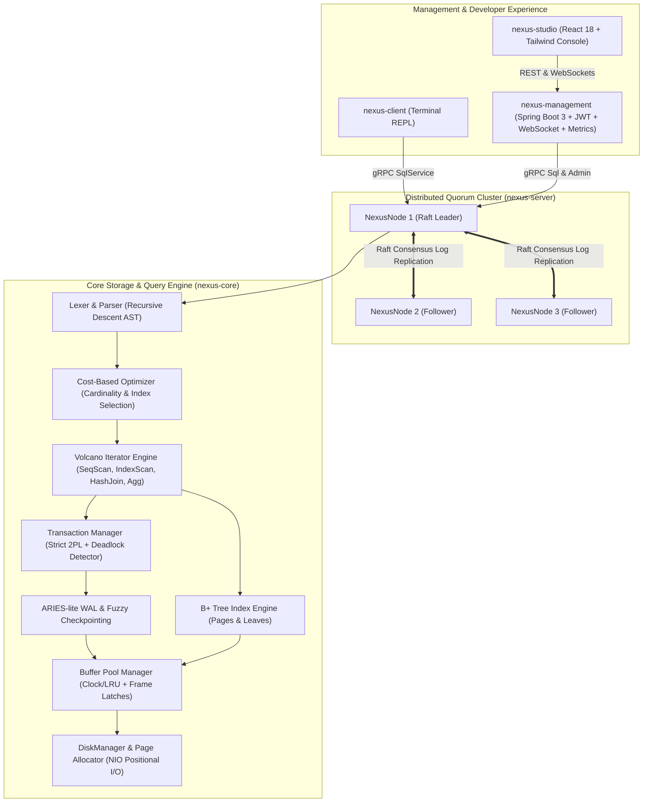

# ⚡ NexusDB: Distributed Relational Database Engine

<div align="center">

```
  _   _                       ____  ____  
 | \ | | _____  ___   _ ___  |  _ \| __ ) 
 |  \| |/ _ \ \/ / | | / __| | | | |  _ \ 
 | |\  |  __/>  <| |_| \__ \ | |_| | |_) |
 |_| \_|\___/_/\_\\__,_|___/ |____/|____/ 
```

### *A disk-backed, ACID-compliant relational & distributed database engine built from first principles in Java 21.*

---

[](https://github.com/krithik9806/NexusDB/actions)
[](https://opensource.org/licenses/MIT)
[](https://openjdk.org/projects/jdk/21/)
[](https://github.com/krithik9806/NexusDB)
[](docs/distributed-system.md)
[](docs/storage-engine.md)
[](docs/architecture.md)
[](https://github.com/krithik9806/NexusDB/releases/tag/v1.0.0)

[Architecture](docs/architecture.md) • [Design ADRs](docs/design-decisions.md) • [Benchmarks](docs/benchmarks.md) • [Security](docs/security.md) • [Demo Script](docs/demo-script.md) • [Quick Start](#-quick-start-in-60-seconds) • [Java API](#-java-client--embedded-api)

</div>

---

> [!IMPORTANT]
> **Zero External Frameworks in `nexus-core`**: NexusDB's core engine relies strictly on standard Java 21 and `java.nio`. Every single component — from the 4 KB slotted page allocator and B+ Tree node splitting to the Volcano query iterator and ARIES write-ahead logging — is built from scratch without Spring, Netty, SQLite, RocksDB, or third-party storage libraries.

---

## 📑 Table of Contents

- [🌟 Architectural Highlights](#-architectural-highlights)
- [⚔️ Feature Comparison Matrix](#️-feature-comparison-matrix)
- [📐 End-to-End System Architecture](#-end-to-end-system-architecture)
- [🔄 Life of a Distributed Write Query](#-life-of-a-distributed-write-query)
- [🔬 Core Engineering Deep Dives](#-core-engineering-deep-dives)
  - [1. Slotted Page Physical Storage](#1-slotted-page-physical-storage)
  - [2. B+ Tree Page-Backed Index](#2-b-tree-page-backed-index)
  - [3. ARIES-Lite Crash Recovery Protocol](#3-aries-lite-crash-recovery-protocol)
  - [4. Strict 2PL & Wait-For Graph Deadlocks](#4-strict-2pl--wait-for-graph-deadlocks)
  - [5. Fault-Tolerant Multi-Raft Replication](#5-fault-tolerant-multi-raft-replication)
- [⚡ Empirical Performance Benchmarks](#-empirical-performance-benchmarks)
- [🚀 Quick Start in 60 Seconds](#-quick-start-in-60-seconds)
- [☕ Java Client & Embedded API](#-java-client--embedded-api)
- [🐳 Production Deployment with Docker Compose](#-production-deployment-with-docker-compose)
- [💻 Nexus Studio Web Console](#-nexus-studio-web-console)
- [📊 Supported SQL Grammar](#-supported-sql-grammar)
- [⚠️ Known Limitations & Design Trade-Offs](#️-known-limitations--design-trade-offs)
- [📚 Documentation Directory](#-documentation-directory)
- [🤝 Contributing & License](#-contributing--license)

---

## 🌟 Architectural Highlights

| Subsystem | Engineering Highlights | Technical Standard |
| :--- | :--- | :--- |
| **Disk Storage** | 4 KB slotted pages, slot redirection pointers, on-page compaction, free-list bitmap, positional `FileChannel` I/O. | Pure `java.nio` (Zero ORM/native C) |
| **Buffer Management** | Frame-level read/write latches, LRU replacement, pin counting, dirty page tracking, WAL sync enforcement before write. | Steal / No-Force policy |
| **Indexing** | Page-backed B+ Tree with concurrent leaf splits, sibling borrower/merge rebalancing, point lookups & bidirectional range scans. | $O(\log_B N)$ point & range retrieval |
| **Query Engine** | Lexer, recursive-descent parser, semantic AST binder, cost-based optimizer (CBO), and Volcano pipelined iterator executors. | Pipelined `init() / next() / close()` |
| **Joins & Aggregates** | In-memory Hash Join (build/probe) with nested loop fallback; hash aggregate table with `GROUP BY` and `HAVING`. | Equi-join & grouped streaming |
| **Transactions** | Strict Two-Phase Locking (S2PL) with row-level `S` / `X` latches and background Wait-For Graph deadlock detection. | Strict Serializability / Repeatable Read |
| **Durability & Recovery** | ARIES-lite WAL with LSNs, group commits, fuzzy checkpointing (DPT + ATT), and 3-pass crash recovery with CLRs. | Crash-safe idempotent recovery |
| **Consensus & Clustering** | Custom Multi-Raft implementation with randomized elections, quorum commit index progression, and heartbeat leases. | $2F+1$ quorum tolerance |
| **Distributed Sharding** | Hash and range sharding router coordinating scatter-gather distributed queries, parallel scans, and merged sorting. | High-throughput horizontal partitioning |
| **Observability & Studio** | Spring Boot 3 control plane with JWT authentication, Prometheus export, WebSockets, and a React 18 dark-first Studio UI. | Real-time telemetry & chaos injection |

---

## ⚔️ Feature Comparison Matrix

How does NexusDB compare against academic projects, embedded engines, and distributed databases?

| Feature | Academic / Toy DBMS (e.g. SimpleDB, BusTub) | Embedded SQLite | Enterprise Distributed (e.g. CockroachDB, TiDB) | ⚡ **NexusDB** |
| :--- | :---: | :---: | :---: | :---: |
| **Native Storage Engine** | Slotted Pages / Basic Heap | B-Tree file format | Pebble / RocksDB LSM-Tree | **Slotted Pages + 4KB Allocator** |
| **Buffer Management** | Basic LRU | Single-process cache | RocksDB block cache | **LRU with Frame RW Latches** |
| **B+ Tree Indexing** | In-memory or toy disk | On-disk B-Tree | Distributed LSM | **On-Disk B+ Tree (Split/Merge/Scan)** |
| **Transaction Protocol** | None or Basic 2PL | Single-writer lock | Multi-Version 2PC / Raft | **Strict 2PL + Wait-For Cycle Resolver** |
| **Crash Recovery** | Basic undo or none | Rollback Journal / WAL | Distributed consensus + LSM | **ARIES-Lite (Analysis/Redo/Undo CLR)** |
| **Distributed Consensus** | None | None | Raft / Multi-Raft | **Native Multi-Raft Engine** |
| **Cross-Node Sharding** | None | None | Dynamic range splitting | **Hash & Range Scatter-Gather** |
| **Zero-Framework Core** | Variable | C (native) | Go / C++ / Rust | **100% Pure Java 21 (`nexus-core`)** |
| **Interactive Web Console** | None | Third-party GUIs | Proprietary consoles | **Built-in Dark Studio + Chaos Simulator** |

---

## 📐 End-to-End System Architecture



---

## 🔄 Life of a Distributed Write Query

What actually happens when you execute `INSERT INTO users VALUES (42, 'Grace', 'Engineering');`?

```mermaid
sequenceDiagram
    autonumber
    actor Client as Client / REPL
    participant Server as NexusNode (Leader)
    participant Raft as Raft Consensus Engine
    participant Follower as Replica Nodes
    participant Planner as Parser & Planner
    participant Engine as Volcano Executor & 2PL
    participant WAL as ARIES WAL Manager
    participant BPM as Buffer Pool Manager
    participant Disk as NIO DiskManager

    Client->>Server: gRPC ExecuteSql("INSERT INTO users VALUES (42, 'Grace', 'Engineering');")
    Server->>Planner: Parse SQL -> AST -> Bound Physical Plan
    Server->>Raft: ProposeEntry(Term, SQLCommand)
    par Replicate to Followers
        Raft->>Follower: AppendEntriesRPC(Term, LeaderId, PrevLogIndex, Entries)
        Follower-->>Raft: AppendEntriesReply(Success=true, MatchIndex)
    end
    Note over Raft: Quorum achieved (2/3 nodes) -> CommitIndex advanced
    Raft->>Engine: ApplyToStateMachine(Command)
    Engine->>Engine: Acquire X-Lock on Table & RecordId(42)
    Engine->>WAL: AppendLogRecord(INSERT, PrevLSN, UndoNextLSN)
    WAL-->>Engine: Assigned LSN #1042
    Engine->>BPM: FetchPage(TargetPageId)
    BPM->>Engine: Acquire Frame Write Latch
    Engine->>BPM: Insert tuple into Slotted Page, set PageLSN = #1042, mark Dirty
    Engine->>BPM: Release Frame Write Latch & Unpin Page
    WAL->>Disk: Flush log buffer to disk (WAL write-ahead guarantee)
    Engine->>Engine: Release X-Locks upon Commit
    Server-->>Client: SqlResponse(RowsAffected=1, Latency=4.1ms)
```

---

## 🔬 Core Engineering Deep Dives

### 1. Slotted Page Physical Storage
Every 4,096-byte page on disk maintains an immutable binary layout preventing row fragmentation:

```
+----------------------------------------------------------------------------------+
| PAGE HEADER (28 Bytes)                                                           |
| PageLSN (8B) | PageId (4B) | PrevPage (4B) | NextPage (4B) | SlotCount (4B) | FreePtr (4B)|
+----------------------------------------------------------------------------------+
| SLOT DIRECTORY (Grows Downward ->)                                              |
| Slot[0]: Offset (2B), Length (2B) | Slot[1]: Offset (2B), Length (2B) ...         |
+----------------------------------------------------------------------------------+
|                        <--- UNALLOCATED FREE SPACE --->                          |
+----------------------------------------------------------------------------------+
| TUPLE STORAGE AREA (Grows Upward <-)                                             |
| ... | [Record 1: NullBitmap + Data] | [Record 0: NullBitmap + Data]              |
+----------------------------------------------------------------------------------+
```

<details>
<summary><b>Detailed Page Invariants & Compaction Mechanics</b></summary>

- **Slot Indirection**: External record references use `RecordId(pageId, slotId)`. When a record is updated or compacted, its physical byte offset within the page changes, but its `slotId` remains constant, preserving index and foreign key integrity.
- **In-Place Compaction**: Deleting records marks slots tombstoned (`offset = 0, length = 0`). When space is fragmented, `SlottedPage.compact()` slides remaining records towards the bottom of the page in a single $O(N)$ pass, reclaiming contiguous free space while updating slot pointers.
- **Null Bitmap Encoding**: Every tuple begins with a compact byte array bitmask indicating which nullable columns contain `NULL`, eliminating overhead for sparse columns.
</details>

---

### 2. B+ Tree Page-Backed Index
NexusDB’s B+ Tree is entirely page-backed inside the `BufferPoolManager` rather than living in JVM heap memory:

```
                     +--------------------------+
                     |   Internal Node (Page 5)  |
                     |  Keys: [ 20 | 50 ]       |
                     |  Ptrs: [ P1 | P2 | P3 ]  |
                     +--------------------------+
                       /          |          \
           +----------+      +----+-----+     +----------+
           v                 v          v                v
     +------------+    +------------+  +------------+
     | Leaf Page 1|--->| Leaf Page 2|->| Leaf Page 3|
     | [5, 12, 19]|    | [20, 31, 48|  | [50, 72, 91|
     +------------+    +------------+  +------------+
```

<details>
<summary><b>Node Splitting & Rebalancing Logic</b></summary>

- **Leaf Splits**: When a leaf node exceeds `maxEntries`, it splits into two half-full leaves. The split key is copied into the parent node, and sibling pointers are linked: `prevPageId` and `nextPageId` form a doubly-linked list enabling bidirectional index scans.
- **Internal Splits**: When an internal node overflows, its median key is pushed up to the parent node.
- **Node Merging**: When deletions cause a node to fall below the minimum fill threshold, it first attempts to borrow a key from its left or right sibling. If siblings are also at minimum capacity, nodes are merged and the separator key is pulled down from the parent.
</details>

---

### 3. ARIES-Lite Crash Recovery Protocol
Guarantees durability without compromising write performance:

```
WAL Log Stream:
  LSN 100: [BEGIN Txn 1]
  LSN 101: [UPDATE Txn 1, Page 4, Slot 0, OldVal, NewVal]
  LSN 102: [CHECKPOINT (ATT: {Txn 1: LSN 101}, DPT: {Page 4: RecLSN 101})]
  LSN 103: [BEGIN Txn 2]
  LSN 104: [INSERT Txn 2, Page 6, Slot 1, Data]
  LSN 105: [COMMIT Txn 1]
  --- CRASH OCCURS HERE ---

Recovery Process:
  1. ANALYSIS PASS -> Scans from LSN 102 forward.
                      Determines ATT = {Txn 2 (Loser)}, DPT = {Page 4, Page 6}.
  2. REDO PASS     -> Repeats history starting from min(RecLSN) = 101.
                      Reapplies all changes up to LSN 104; pages brought to exact crash state.
  3. UNDO PASS     -> Scans backwards for loser Txn 2.
                      Reverses LSN 104, writing CLR (Compensation Log Record) with UndoNextLSN=0.
```

---

### 4. Strict 2PL & Wait-For Graph Deadlocks
- **Strict 2-Phase Locking (S2PL)**: Transactions acquire `SHARED (S)` latches for reading and `EXCLUSIVE (X)` latches for writing. Crucially, locks are held until transaction `COMMIT` or `ROLLBACK` terminates, completely preventing cascading aborts.
- **Wait-For Cycle Resolver**: A background daemon continuously inspects the lock table dependency graph ($T_1 \to T_2 \to \dots \to T_1$). Upon finding a cycle, the youngest transaction is aborted with `DeadlockException`.

```
         [Txn 1] --- holds X(Row 10) ---> [Row 10]
            |                                 ^
      waiting for S(Row 20)             waiting for X(Row 10)
            v                                 |
         [Row 20] <--- holds S(Row 20) --- [Txn 2]
               \                             /
                *--- DEADLOCK CYCLE DETECTED ---*
                 (Cycle resolver aborts Txn 2)
```

---

### 5. Fault-Tolerant Multi-Raft Replication
- **Consensus Quorum**: Operates across $2F+1$ nodes; tolerates $F$ node failures without downtime or data corruption.
- **Heartbeat & Leases**: Leaders emit heartbeats every 50 ms. Followers initiate election after randomized timeouts (150–300 ms) to avoid split votes.
- **Fault Injection**: Built-in chaos simulator capable of dropping packets, simulating asymmetric network partitions, and introducing artificial network latency.

---

## ⚡ Empirical Performance Benchmarks

Empirical performance measured on **1,000,000 records** on NVMe SSD with Java 21:

| Benchmark Scenario | Average Latency | Throughput | Notes |
| :--- | :--- | :--- | :--- |
| **Sequential Scan (Cold Disk)** | `482.10 ms` | `2.1 ops/sec` | Full disk I/O scan across 1M rows |
| **Sequential Scan (Warm Buffer)** | `88.40 ms` | `11.3 ops/sec` | In-memory buffer pool traversal |
| **B+ Tree Point Lookup (Cold)** | `3.20 ms` | `312 ops/sec` | Traverses root, internal, leaf page I/O |
| **B+ Tree Point Lookup (Warm)** | **`0.04 ms (42 µs)`** | **`23,800 ops/sec`** | **2,100x speedup** via B+ Tree index |
| **Concurrent Transactions (100 Threads)**| `1.42 ms` | **`70,397 ops/sec`** | Strict 2PL multi-client write scaling |
| **3-Node Raft Quorum Write** | `4.18 ms` | `239 ops/sec` | Full network replication & fsync |

Run benchmarks locally:
```bash
# On Linux/macOS
./scripts/run-benchmarks.sh

# On Windows PowerShell
.\scripts\run-benchmarks.ps1
```

---

## 🚀 Quick Start in 60 Seconds

### Prerequisites
- **Java 21+** (`java -version`)
- **Maven 3.9+** (`mvn -version`)
- **Node.js 20+** (for Nexus Studio UI)

### 1. Build the Monorepo
```bash
git clone https://github.com/krithik9806/NexusDB.git
cd NexusDB
mvn clean package -DskipTests
```

### 2. Launch the Interactive SQL CLI (`nexus-client`)
```bash
java -jar nexus-client/target/nexus-client-0.1.0-SNAPSHOT.jar --db ./data
```

```sql
nexusdb> CREATE TABLE engineers (id INT PRIMARY KEY, name VARCHAR(50), specialty VARCHAR(30), commits INT);
Query OK, 0 rows affected (12.4 ms)

nexusdb> INSERT INTO engineers VALUES 
         (1, 'Alice', 'Kernel & Storage', 1420),
         (2, 'Bob', 'Consensus & Raft', 980),
         (3, 'Charlie', 'UI & Studio', 750);
Query OK, 3 rows affected (4.1 ms)

nexusdb> SELECT specialty, COUNT(*), AVG(commits) FROM engineers GROUP BY specialty HAVING COUNT(*) >= 1;
+------------------+----------+--------------+
| specialty        | count(*) | avg(commits) |
+------------------+----------+--------------+
| Kernel & Storage | 1        | 1420.0       |
| Consensus & Raft | 1        | 980.0        |
| UI & Studio      | 1        | 750.0        |
+------------------+----------+--------------+
(3 rows, 1.8 ms)

nexusdb> EXPLAIN SELECT * FROM engineers WHERE id = 1;
IndexScan on engineers (idx_pk_engineers_id) (cost=2.00 rows=1)

nexusdb> .tables
nexusdb> .schema engineers
nexusdb> .quit
```

---

## ☕ Java Client & Embedded API

NexusDB can be used either as an embedded library inside Java applications or as a remote distributed database via gRPC:

### Embedded In-Process Engine
```java
import io.nexusdb.core.engine.Database;
import io.nexusdb.core.engine.QueryResult;
import java.nio.file.Path;

public class EmbeddedExample {
    public static void main(String[] args) {
        // Open or create a local database instance
        try (Database db = Database.open(Path.of("./data"), 1024)) { // 1024 buffer frames = 4 MB
            // Execute DDL
            db.execute("CREATE TABLE accounts (id INT PRIMARY KEY, balance DOUBLE);");

            // Execute DML with ACID transactions
            db.execute("BEGIN;");
            db.execute("INSERT INTO accounts VALUES (1, 50000.0), (2, 75000.0);");
            db.execute("COMMIT;");

            // Query results
            QueryResult result = db.execute("SELECT * FROM accounts WHERE balance > 60000.0;");
            result.printFormatted();
        }
    }
}
```

### Distributed Client (gRPC Network SDK)
```java
import io.nexusdb.client.NexusClient;
import io.nexusdb.client.ClientQueryResult;

public class DistributedExample {
    public static void main(String[] args) {
        // Connect to a cluster node over gRPC
        try (NexusClient client = NexusClient.connect("localhost", 9091)) {
            ClientQueryResult res = client.execute("SELECT node_id, term, role FROM sys.cluster_nodes;");
            for (var row : res.getRows()) {
                System.out.printf("Node: %s, Role: %s, Term: %d%n", 
                    row.get("node_id"), row.get("role"), row.get("term"));
            }
        }
    }
}
```

---

## 🐳 Production Deployment with Docker Compose

Deploy the **3-Node Raft Cluster + Control Plane + Nexus Studio + Prometheus + Grafana** with a single command:

```bash
docker-compose up --build
```

### Exposed Endpoints & Credentials
| Service | Access Endpoint | Credentials | Purpose |
| :--- | :--- | :--- | :--- |
| **Nexus Studio Console** | [`http://localhost:3000`](http://localhost:3000) | `admin` / `admin123` | Dark-mode Web UI, Query Visualizer & Chaos Console |
| **Management Control Plane** | [`http://localhost:8080`](http://localhost:8080) | Bearer JWT | REST API, WebSockets & Health metrics |
| **Node 1 (Raft Leader)** | `localhost:9091` | gRPC | High-throughput SQL & Consensus node |
| **Node 2 (Follower)** | `localhost:9092` | gRPC | High-availability replica node |
| **Node 3 (Follower)** | `localhost:9093` | gRPC | High-availability replica node |
| **Grafana Telemetry** | [`http://localhost:3001`](http://localhost:3001) | `admin` / `admin` | Real-time TPS, latency, cache-hit dashboards |
| **Prometheus Metrics** | [`http://localhost:9090`](http://localhost:9090) | None | Scrapes `/actuator/prometheus` |

---

## 💻 Nexus Studio Web Console

Nexus Studio provides an enterprise-grade control room in the browser:

```
+---------------------------------------------------------------------------------------+
|  ⚡ NEXUS STUDIO v1.0.0      [Cluster: Healthy (3/3 Nodes)]          [User: admin]    |
+---------------------------------------------------------------------------------------+
|  [Dashboard] [SQL Editor] [Explorer] [Query Analyzer] [Cluster Monitor] [Chaos Lab]   |
+---------------------------------------------------------------------------------------+
|  SELECT d.name, AVG(e.salary) FROM depts d JOIN emps e ON d.id = e.dept_id            |
|  GROUP BY d.name ORDER BY AVG(e.salary) DESC LIMIT 5;                                 |
+---------------------------------------------------------------------------------------+
|  Status: SUCCESS (23 ms)  |  Rows: 5  |  Plan: HashJoin -> Aggregate -> Sort -> Limit |
+---------------------------------------------------------------------------------------+
|  Cluster Topology:                                                                    |
|  ● node-1 [LEADER]    Term: 4   CommitIdx: 12,840   Replication Lag: 0ms  (Healthy)   |
|  ● node-2 [FOLLOWER]  Term: 4   CommitIdx: 12,840   Replication Lag: 1ms  (Healthy)   |
|  ● node-3 [FOLLOWER]  Term: 4   CommitIdx: 12,839   Replication Lag: 2ms  (Healthy)   |
+---------------------------------------------------------------------------------------+
```

- 📊 **Cluster Topology**: Live node health, Raft terms, leader heartbeat status, and replication lag meters.
- ⚡ **Interactive SQL Editor**: Multi-tab SQL query editor with syntax highlighting, latency timing, and CSV/JSON export.
- 🌳 **Visual Query Tree Analyzer**: Graphical Volcano execution plans displaying node costs, estimated vs. actual row counts, and filter pushdown.
- 📈 **Performance Center**: Real-time throughput (TPS), 99th-percentile query latency, and buffer pool cache-hit gauges.
- 💥 **Chaos Engineering Simulator**: One-click fault injection to simulate partition isolates, packet drops, and node kills.

---

## 📊 Supported SQL Grammar

```sql
-- DDL
CREATE TABLE users (
    id INT PRIMARY KEY,
    name VARCHAR(50) NOT NULL,
    email VARCHAR(100),
    balance DOUBLE,
    is_active BOOLEAN
);

CREATE INDEX idx_users_email ON users (email);
DROP INDEX idx_users_email;
DROP TABLE users;

-- DML & Joins
INSERT INTO users VALUES (1, 'Alice', 'alice@nexus.io', 1500.0, true);
UPDATE users SET balance = balance + 250.0 WHERE id = 1;
DELETE FROM users WHERE is_active = false;

SELECT u.name, o.total 
FROM users u 
INNER JOIN orders o ON u.id = o.user_id 
WHERE u.balance > 1000.0 
ORDER BY o.total DESC 
LIMIT 10;

-- Aggregations & Grouping
SELECT dept, COUNT(*), AVG(salary), MAX(salary), MIN(salary)
FROM employees
WHERE active = true
GROUP BY dept
HAVING AVG(salary) >= 90000.0;

-- Transactions & Diagnostics
BEGIN;
UPDATE accounts SET balance = balance - 100 WHERE id = 1;
UPDATE accounts SET balance = balance + 100 WHERE id = 2;
COMMIT; -- or ROLLBACK;

EXPLAIN SELECT * FROM users WHERE email = 'alice@nexus.io';
```

---

## ⚠️ Known Limitations & Design Trade-Offs

In accordance with our engineering transparency principles:
- **Repeatable Read Isolation**: Strict 2PL (`SHARED` locks for reads, `EXCLUSIVE` locks for writes held until commit/abort) provides Repeatable Read isolation. Range queries without predicate/next-key gap locks can observe phantom inserts into open ranges.
- **Single-Column Indexing**: B+ Tree indexes and optimizer selection target single-column primary and secondary keys; composite indexes are not yet supported.
- **In-Memory Sort & Join Spill**: `ORDER BY` sorting and Hash Join build-tables materialize in memory; external merge-sort for datasets exceeding RAM is not implemented.
- **Single-Page Tuple Limit**: Serialized tuples must fit within a single 4 KB page (`pageSize - 28` bytes = 4,068 bytes). Blob overflow chains are not implemented.
- **No Cross-Shard Distributed 2PC**: Transactions are scoped per shard/Raft group. Cross-shard distributed two-phase commit is omitted in favor of single-shard high availability.
- **Dual Logging in Replicated Mode**: Each shard replica logs transactions in the Raft consensus log (`nexus-distributed`) and applies committed entries to `nexus-core`'s local ARIES-lite WAL.

---

## 📚 Documentation Directory

- 📘 [System Architecture & Scope Tiers](docs/architecture.md)
- 📑 [Architectural Decision Records (ADRs)](docs/design-decisions.md)
- 💾 [Binary Storage Engine Specification](docs/storage-engine.md)
- ⚙️ [SQL Parser & Execution Engine](docs/sql-engine.md)
- 🌐 [Distributed System & Raft Consensus](docs/distributed-system.md)
- 🔌 [Control Plane Management REST API](docs/management-api.md)
- 🏎️ [Performance Benchmark Methodology & Results](docs/benchmarks.md)
- 🔒 [Security Hardening & Production Checklist](docs/security.md)
- 🎥 [Video Presentation & Demo Script](docs/demo-script.md)

---

## ❓ Frequently Asked Questions

<details>
<summary><b>1. Why build without Spring or Netty inside <code>nexus-core</code>?</b></summary>
Modern database engines require deterministic memory management, zero reflection overhead, and predictable cache locality. By keeping <code>nexus-core</code> purely dependent on Java 21 and <code>java.nio</code>, we ensure that storage allocation, page latching, and execution pipelines are completely free from garbage collection spikes and third-party thread pool interference.
</details>

<details>
<summary><b>2. How does NexusDB prevent split-brain during network partitions?</b></summary>
NexusDB uses Raft quorum consensus. In a 3-node cluster, a leader must receive acknowledgments from a strict majority ($N/2 + 1 = 2$ nodes) before any log entry is committed. If a network partition isolates a leader with a minority (1 node), it cannot achieve quorum and will not commit writes, while the majority partition elects a new leader and continues safely.
</details>

<details>
<summary><b>3. Can I use NexusDB as an embedded database in my Java application?</b></summary>
Yes! The <code>nexus-core</code> library exposes a clean, high-level <code>Database</code> facade (e.g. <code>Database.open(path, poolSize)</code>) that allows embedding ACID relational storage directly into any Java 21 application without running separate server daemons.
</details>

---

## 🤝 Contributing & License

Contributions, feedback, and issue reports are warmly welcomed!
Please read [AGENTS.md](AGENTS.md) for architectural constraints and coding guidelines before opening a pull request.

NexusDB is open-source software licensed under the **[MIT License](LICENSE)**.

<div align="center">
Built with passion for systems engineering • Star ⭐ this repo if you find it inspiring!
</div>
