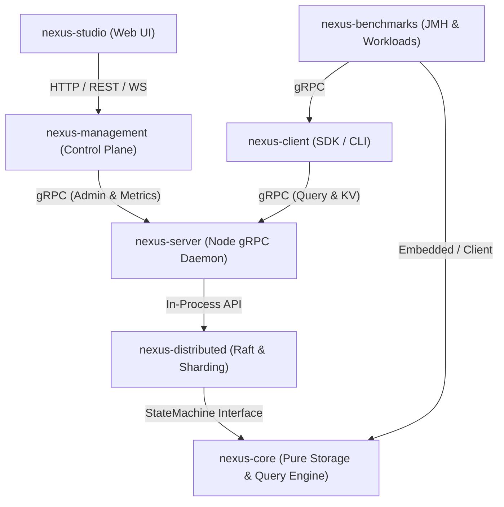
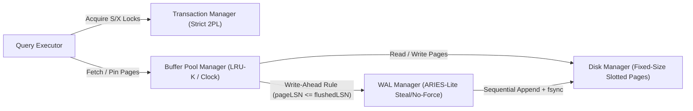
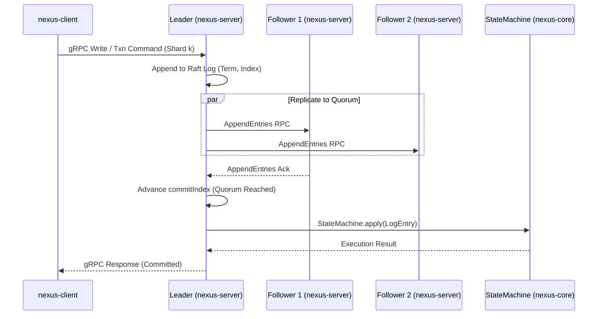

# NexusDB Architecture

NexusDB is a modular, disk-backed transactional storage and distributed database engine written in Java 21. It is structured around strict module boundaries and progressive scope tiers so that the single-node storage engine remains a pure, deterministic library independent of networking or consensus frameworks.

---

## 1. Module Boundaries

NexusDB enforces strict unidirectional dependencies across modules:

1. **`nexus-core` (Pure Engine Library)**
   - Contains the page-oriented disk manager, buffer pool manager, steal/no-force ARIES-lite Write-Ahead Log (WAL), B+Tree index, slotted-page heap storage, concurrency manager (Strict 2PL and latches), and SQL/query execution engine.
   - **Boundary invariant**: Pure Java 21 library. No Spring, no HTTP/gRPC frameworks, and no awareness of network sockets or cluster topology.
2. **`nexus-distributed` (Consensus & Sharding Layer)**
   - Wraps `nexus-core` exclusively through a deterministic `StateMachine` interface (`apply(LogEntry)`, `snapshot()`, `restore(Snapshot)`).
   - Implements Multi-Raft consensus (one Raft group per shard), log replication, leader election, and range/hash shard routing.
3. **`nexus-server` (Node Daemon & gRPC Endpoint)**
   - Hosts a storage/consensus node process exposing gRPC endpoints for client requests, inter-node Raft RPCs (`RequestVote`, `AppendEntries`, `InstallSnapshot`), and node administration RPCs.
4. **`nexus-client` (Client Driver & Routing SDK)**
   - Provides the client-side connection pool, gRPC stubs, leader/shard routing table cache, and retry logic.
5. **`nexus-management` (Cluster Control Plane & Observability API)**
   - Communicates **only with `nexus-server` nodes over gRPC** (never accesses `nexus-core` disk files or in-memory internals directly).
   - Aggregates cluster health, Raft term/leader state, buffer pool metrics, and shard placement for operators.
6. **`nexus-studio` (Web UI & Visual Inspector)**
   - Talks **only to `nexus-management`** over its HTTP/WebSocket API. Never connects directly to `nexus-server` nodes or `nexus-core`.
7. **`nexus-benchmarks` (Workload & Microbenchmark Suite)**
   - JMH microbenchmarks and YCSB-style transactional workloads targeting both embedded `nexus-core` and clustered deployments.

### Module Dependency & Communication Diagram

---

## 2. Single-Node Storage Engine Internals (`nexus-core`)

Within `nexus-core`, data flows through a classic page-oriented, write-ahead logged architecture:

### Core Invariants
- **Write-Ahead Logging (WAL) Invariant**: Before a dirty page $P$ with `pageLSN` is evicted or flushed to disk by the Buffer Pool Manager, the WAL Manager must ensure `flushedLSN >= P.pageLSN`.
- **Commit Durability Invariant**: A transaction is committed only after its `COMMIT` log record is flushed (`fsync`) to the WAL on disk.
- **Pin/Latch Discipline**: Threads pin buffer frames before acquiring page read/write latches, never hold page latches across disk I/O, and release latches in reverse acquisition order (or Crabbing order in B+Tree traversal).

---

## 3. Distributed Architecture (`nexus-distributed` & `nexus-server`)

Each shard in NexusDB is replicated as an independent Raft consensus group. A physical `nexus-server` node can host replicas (peers) for multiple shards (Multi-Raft), where each shard replica drives its own isolated `StateMachine` backed by `nexus-core`.

---

## 4. Scope Tiers

NexusDB is engineered in three progressive, verifiable tiers:

| Tier | Focus | Key Components & Milestones |
| :--- | :--- | :--- |
| **Tier 1** | **Single-Node Engine (`nexus-core`)** | Fixed-size slotted pages, `DiskManager`, `BufferPoolManager` with eviction & pin tracking, steal/no-force ARIES-lite WAL & crash recovery (Analysis, Redo, Undo), latched B+Tree index, Strict 2PL lock manager with deadlock detection/prevention, and single-node SQL/relational execution. |
| **Tier 2** | **Raft Replication (`nexus-distributed`, `nexus-server`)** | Deterministic `StateMachine` wrapper around `nexus-core`, Raft leader election, log replication, safety invariants, snapshotting & log compaction, gRPC transport in `nexus-server`, and failover-aware client in `nexus-client`. |
| **Tier 3** | **Sharding & Studio (`nexus-management`, `nexus-studio`)** | Partitioning data across multiple Raft groups (one Raft group per shard), shard routing metadata, `nexus-management` gRPC cluster aggregator, and `nexus-studio` web dashboard talking exclusively to `nexus-management`. |
