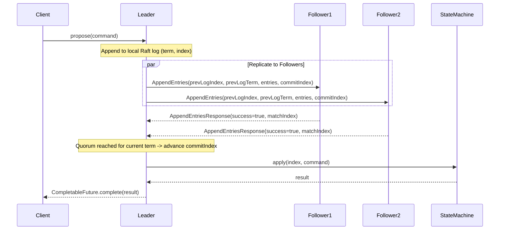

# NexusDB Distributed System Specification

This document specifies the consensus, replication, and distributed clustering protocols in `nexus-distributed` and `nexus-server`.

---

## 1. Raft Consensus Architecture

NexusDB uses a deterministic Raft implementation based on the Ongaro & Ousterhout paper (*In Search of an Understandable Consensus Algorithm*).

### State Machine Replication Pipeline

---

## 2. Invariants & Safety Guarantees

1. **Election Safety (§5.2)**: At most one leader can be elected in a given term. A candidate must receive votes from a strict majority ($\lfloor N/2 \rfloor + 1$) of nodes, and each voter persists at most one vote per term in `RaftStorage`.
2. **Leader Append-Only (§5.3)**: A leader never overwrites or truncates its own log entries; it only appends new entries.
3. **Log Matching (§5.4)**: If two logs contain an entry with the same index and term:
   - they store the same command, and
   - their logs are identical in all entries up through the given index.
4. **Leader Completeness (§5.4.1)**: If a log entry is committed in a given term, then that entry will be present in the logs of the leaders for all higher-numbered terms. Enforced during elections: a voter rejects a candidate whose log is less up-to-date (comparing `(lastLogTerm, lastLogIndex)`).
5. **Current-Term Commit Rule (§5.4.2)**: A leader never commits log entries from previous terms by counting replicas alone. `commitIndex` is advanced to index $N$ only if a majority of peers have replicated up to $N$ and the entry at $N$ was created in the leader's `currentTerm`.
6. **State Machine Safety (§5.4.3)**: If a server has applied a log entry at a given index to its state machine, no other server will ever apply a different log entry for the same index.

---

## 3. Replication & Client Interaction Policy

### Transaction & Write Mapping
All write operations (DDL `CREATE TABLE`, `DROP TABLE`, and DML `INSERT`, `UPDATE`, `DELETE`) are replicated through Raft consensus prior to state machine application:
1. **Leader Execution**: Clients send write requests to the current Raft leader. If a follower receives a write request, it responds with `NOT_LEADER: leader is <leaderId>`.
2. **Log Proposal**: The leader packages the command string into a `RaftLogEntry` and calls `raftNode.propose(command)`.
3. **Quorum Replication**: The leader replicates the entry via `AppendEntries` to followers.
4. **Deterministic Apply**: Once quorum acknowledgment is received, the leader advances its `commitIndex` and applies the command to its local `Database` through `DatabaseStateMachine.apply()`. Followers apply the command in identical index order once `leaderCommit` advances.

### Read Policy
- **Leader Reads (Default)**: Consistent reads execute directly on the leader, guaranteeing that all previously committed writes are visible.
- **Follower Reads (Stale)**: Follower reads can be served locally for read-scaling if the client permits reads up to the follower's `lastApplied` index.

---

## 4. Failure Recovery & Fault Injection

### Recovery Policy & Rejoin Catch-up
- **Heartbeat Failure Detection**: Nodes monitor heartbeats within a randomized timeout window ($[150, 300\text{ ms}]$). If a leader fails, remaining nodes detect heartbeat cessation and initiate a new election.
- **Node Rejoin & Log Catch-Up**: When a partitioned or crashed follower rejoins, the leader uses its `nextIndex[peer]` and fast conflict backtracking to transmit missing entries from its log. The rejoining follower appends missing entries and advances `commitIndex` once instructed by the leader, restoring cluster consistency without requiring a full snapshot.
- **Single History Invariant**: If a partitioned minority leader attempts to accept writes, it cannot achieve quorum commit. Upon network heal, it steps down to follower upon observing a higher term, discards any uncommitted local entries, and adopts the canonical history established by the majority.

### Transport Fault Injection
The `AdminService` gRPC endpoint enables dynamic fault simulation:
- `DROP_TRAFFIC`: Simulates network partitions or isolated nodes by intercepting and silently discarding outbound RPCs to specific peers.
- `ADD_LATENCY`: Injects artificial network delay into inter-node transport.
- `CLEAR_FAULTS`: Resets all active simulated faults.

---

## 5. Multi-Raft Sharding & Scatter-Gather Routing

### Multi-Raft Architecture
NexusDB partitions data across independent **Multi-Raft shards**:
- Each table is partitioned using either a `HASH` or `RANGE` strategy on a designated shard key column (e.g. `PRIMARY KEY`).
- Every shard constitutes an independent Raft consensus group (with 3 replica nodes).
- A single physical node hosts multiple Raft groups simultaneously, driving independent `StateMachine` instances backed by isolated database files or namespaces.

### Query Routing Policy (ADR-004)
- **Point Queries & Single-Key Writes**: Inspected by `ShardRouter` for the partition key (`WHERE id = ?` or `INSERT INTO ... VALUES (key, ...)`). Routed directly to the owning shard's Raft leader.
- **Scatter-Gather Reads**: Non-keyed `SELECT` queries broadcast to all shards. The coordinator merges partial result sets, applying in-memory `ORDER BY`, `LIMIT`, and aggregate accumulation (`COUNT`, `SUM`, `MIN`, `MAX`).
- **No Cross-Shard Transactions**: Multi-shard writes or multi-shard transactions (`BEGIN ... COMMIT`) spanning multiple shards are explicitly rejected with `UnsupportedCrossShardOperationException`. All ACID guarantees remain strictly local to a single shard.

To keep the consensus core deterministic, inspectable, and robust, the following advanced Raft extensions are currently not implemented:
- **Log Compaction / Snapshots (`InstallSnapshot` RPC)**: Log entries accumulate in `RaftStorage` and are retained across restarts. Snapshotting and log truncation will be evaluated in future phases.
- **Dynamic Membership Changes (Joint Consensus / Single-Server Transitions)**: Cluster membership is statically configured at startup via node IDs and peer lists. Adding or removing nodes dynamically requires cluster restart.
- **Pre-Vote Protocol**: Disconnected nodes with partitioned timers increment terms on election timeout, which may trigger a brief term escalation upon rejoining before stepping down.
- **Linearizable Read Index / Lease Reads**: All reads currently execute either through `propose` or against the local state machine.
