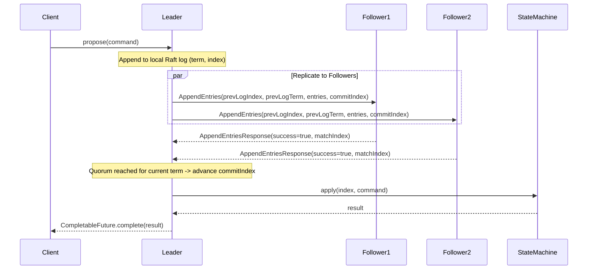

# NexusDB Distributed System Specification

This document specifies the consensus, replication, and distributed clustering protocols in `nexus-distributed` and `nexus-server`.

---

## 1. Raft Consensus Architecture

NexusDB uses a deterministic Raft implementation based on the Ongaro & Ousterhout paper (*In Search of an Understandable Consensus Algorithm*).

### State Machine Replication Pipeline

---

## 2. Invariants & Safety Guarantees

1. **Election Safety (§5.2)**: At most one leader can be elected in a given term. A candidate must receive votes from a strict majority ($\lfloor N/2 \rfloor + 1$) of nodes, and each voter persists at most one vote per term in `RaftStorage`.
2. **Leader Append-Only (§5.3)**: A leader never overwrites or truncates its own log entries; it only appends new entries.
3. **Log Matching (§5.4)**: If two logs contain an entry with the same index and term:
   - they store the same command, and
   - their logs are identical in all entries up through the given index.
4. **Leader Completeness (§5.4.1)**: If a log entry is committed in a given term, then that entry will be present in the logs of the leaders for all higher-numbered terms. Enforced during elections: a voter rejects a candidate whose log is less up-to-date (comparing `(lastLogTerm, lastLogIndex)`).
5. **Current-Term Commit Rule (§5.4.2)**: A leader never commits log entries from previous terms by counting replicas alone. `commitIndex` is advanced to index $N$ only if a majority of peers have replicated up to $N$ and the entry at $N$ was created in the leader's `currentTerm`.
6. **State Machine Safety (§5.4.3)**: If a server has applied a log entry at a given index to its state machine, no other server will ever apply a different log entry for the same index.

---

## 3. What is NOT Implemented (Known Scope Boundaries)

To keep the consensus core deterministic, inspectable, and robust, the following advanced Raft extensions are currently not implemented:
- **Log Compaction / Snapshots (`InstallSnapshot` RPC)**: Log entries accumulate in `RaftStorage` and are retained across restarts. Snapshotting and log truncation will be evaluated in future phases.
- **Dynamic Membership Changes (Joint Consensus / Single-Server Transitions)**: Cluster membership is statically configured at startup via node IDs and peer lists. Adding or removing nodes dynamically requires cluster restart.
- **Pre-Vote Protocol**: Disconnected nodes with partitioned timers increment terms on election timeout, which may trigger a brief term escalation upon rejoining before stepping down.
- **Linearizable Read Index / Lease Reads**: All reads currently execute either through `propose` or against the local state machine.
