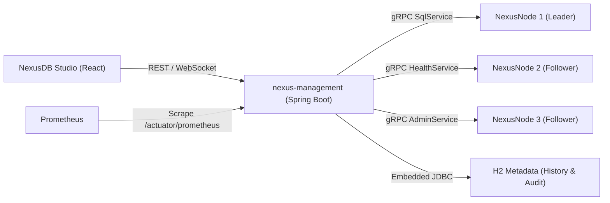

# NexusDB Management Control-Plane API

The `nexus-management` service is a Spring Boot control-plane application providing secured management, telemetry, and administrative orchestration for NexusDB clusters.

## Architecture

## Security & Authentication

- **Authentication Scheme**: Stateless HMAC-SHA256 JWT tokens.
- **Password Hashing**: BCrypt.
- **Roles**:
  - `ADMIN`: Full access (Cluster topology, SQL execution, schema browser, metrics, and fault injection actions).
  - `DEVELOPER`: Read-only cluster telemetry + SQL execution, EXPLAIN, and query history.
  - `VIEWER`: Read-only access to cluster topology, metrics, and schema browser. Fault injection and SQL execution are rejected with `403 Forbidden`.

## Endpoints

### Authentication
- `POST /api/auth/login`: `{ "username": "admin", "password": "..." }` -> `{ "token": "...", "role": "ADMIN", "username": "admin" }`

### Cluster Topology & Nodes
- `GET /api/cluster/topology`: Lists nodes, roles (`LEADER`, `FOLLOWER`), health status, uptime, cache hit ratio, and active transactions.
- `GET /api/nodes/{id}`: Detailed telemetry for a specific cluster node.

### SQL & Schema
- `POST /api/sql/execute`: Executes SQL queries against the cluster. Logs statement to query history.
- `POST /api/sql/explain`: Returns query execution plan.
- `GET /api/sql/history`: Returns recent query execution history.
- `GET /api/schema`: Returns tables, columns, types, and secondary indexes.

### Metrics & Observability
- `GET /api/metrics/timeseries`: In-memory ring buffer (up to 300 points) of throughput, latency percentiles (p50, p95, p99), cache hit ratio, memory usage, and replication lag.
- `GET /actuator/prometheus`: OpenMetrics/Prometheus scrape endpoint.

### Fault Injection (ADMIN Only)
- `POST /api/faults/action`: Injects faults into target cluster nodes (`STOP`, `RESTART`, `PARTITION`, `HEAL`, `FORCE_ELECTION`). Every action is recorded in the persistent audit log.
- `GET /api/faults/audit-log`: Retrieves security and fault injection audit logs.

### WebSocket Stream
- `GET /ws/cluster`: STOMP/SockJS WebSocket endpoint. Broadcasts live cluster topology and metrics to `/topic/cluster`.
