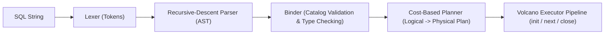

# NexusDB SQL Engine Specification

This document defines the supported SQL grammar (EBNF), data types, expression precedence, three-valued `NULL` semantics, and explicitly unsupported SQL constructs in NexusDB.

---

## 1. EBNF Grammar

Keywords are case-insensitive. Identifiers are case-preserving on definition and matched case-insensitively during binding.

```ebnf
statement          ::= [ "EXPLAIN" [ "ANALYZE" ] ] ( ddl_stmt | dml_stmt | txn_stmt ) [ ";" ] ;

ddl_stmt           ::= create_db_stmt | create_table_stmt | drop_table_stmt
                     | create_index_stmt | drop_index_stmt ;

create_db_stmt     ::= "CREATE" "DATABASE" identifier ;
create_table_stmt  ::= "CREATE" "TABLE" identifier "(" column_def { "," column_def } ")" ;
column_def         ::= identifier data_type [ "PRIMARY" "KEY" ] [ "NOT" "NULL" ] ;
drop_table_stmt    ::= "DROP" "TABLE" identifier ;
create_index_stmt  ::= "CREATE" [ "UNIQUE" ] "INDEX" identifier "ON" identifier "(" identifier ")" ;
drop_index_stmt    ::= "DROP" "INDEX" identifier [ "ON" identifier ] ;

dml_stmt           ::= insert_stmt | select_stmt | update_stmt | delete_stmt ;

insert_stmt        ::= "INSERT" "INTO" identifier [ "(" identifier { "," identifier } ")" ]
                       "VALUES" row_values { "," row_values } ;
row_values         ::= "(" expr { "," expr } ")" ;

select_stmt        ::= "SELECT" select_list
                       "FROM" table_ref { join_clause }
                       [ "WHERE" expr ]
                       [ "GROUP" "BY" expr { "," expr } ]
                       [ "HAVING" expr ]
                       [ "ORDER" "BY" order_item { "," order_item } ]
                       [ "LIMIT" integer_literal ] ;

select_list        ::= "*" | select_item { "," select_item } ;
select_item        ::= expr [ [ "AS" ] identifier ] ;
table_ref          ::= identifier [ [ "AS" ] identifier ] ;
join_clause        ::= ( [ "INNER" ] "JOIN" | "LEFT" [ "OUTER" ] "JOIN" )
                       table_ref "ON" expr ;
order_item         ::= expr [ "ASC" | "DESC" ] ;

update_stmt        ::= "UPDATE" identifier "SET" assignment { "," assignment } [ "WHERE" expr ] ;
assignment         ::= identifier "=" expr ;

delete_stmt        ::= "DELETE" "FROM" identifier [ "WHERE" expr ] ;

txn_stmt           ::= "BEGIN" | "COMMIT" | "ROLLBACK" ;

data_type          ::= "INT" | "INTEGER" | "BIGINT" | "DOUBLE" | "FLOAT"
                     | "BOOLEAN" | "BOOL" | "VARCHAR" "(" integer_literal ")" ;

expr               ::= or_expr ;
or_expr            ::= and_expr { "OR" and_expr } ;
and_expr           ::= not_expr { "AND" not_expr } ;
not_expr           ::= [ "NOT" ] predicate_expr ;
predicate_expr     ::= additive_expr [ ( "=" | "!=" | "<>" | "<" | "<=" | ">" | ">=" ) additive_expr
                                     | "IS" [ "NOT" ] "NULL" ] ;
additive_expr      ::= multiplicative_expr { ( "+" | "-" ) multiplicative_expr } ;
multiplicative_expr::= primary_expr { ( "*" | "/" ) primary_expr } ;
primary_expr       ::= literal
                     | aggregate_call
                     | column_ref
                     | "(" expr ")"
                     | "-" primary_expr ;

aggregate_call     ::= ( "COUNT" | "SUM" | "AVG" | "MIN" | "MAX" ) "(" ( "*" | expr ) ")" ;
column_ref         ::= identifier [ "." identifier ] ;
```

---

## 2. Query Processing Pipeline



---

## 3. Data Types & Coercion Rules

1. **`INT`** (32-bit signed integer)
2. **`BIGINT`** (64-bit signed integer)
3. **`DOUBLE`** (64-bit IEEE 754 floating point)
4. **`BOOLEAN`** (`TRUE` / `FALSE`)
5. **`VARCHAR(n)`** (variable-length UTF-8 string up to `n` characters; inserting a string longer than `n` raises a validation error)

**Implicit Numeric Widening**: `INT` promotes to `BIGINT` or `DOUBLE` in mixed arithmetic/comparison expressions (`INT -> BIGINT -> DOUBLE`). Implicit conversion between strings and numbers is rejected by the Binder.

---

## 4. Three-Valued `NULL` Semantics

NexusDB implements standard SQL three-valued logic (`TRUE`, `FALSE`, `UNKNOWN`/`NULL`):
- Any arithmetic (`+`, `-`, `*`, `/`) or standard comparison (`=`, `!=`, `<`, `<=`, `>`, `>=`) with a `NULL` operand evaluates to `NULL`.
- `IS NULL` and `IS NOT NULL` always evaluate to `TRUE` or `FALSE`.
- **Truth Tables**:
  - `FALSE AND NULL` $\rightarrow$ `FALSE`; `TRUE AND NULL` $\rightarrow$ `NULL`
  - `TRUE OR NULL` $\rightarrow$ `TRUE`; `FALSE OR NULL` $\rightarrow$ `NULL`
  - `NOT NULL` $\rightarrow$ `NULL`
- **`WHERE` and `HAVING` Filters**: Only rows where the predicate evaluates to `TRUE` are emitted (`FALSE` and `NULL` are filtered out).
- **`ORDER BY` Ordering**: `NULL` values sort **last** in `ASC` order (`NULLS LAST`) and **first** in `DESC` order.
- **Aggregates**: `COUNT(*)` counts all rows including `NULL`s; `COUNT(col)`, `SUM`, `AVG`, `MIN`, `MAX` ignore `NULL` inputs. On an empty input set (or all-`NULL` column), `COUNT` returns `0` while `SUM`, `AVG`, `MIN`, `MAX` return `NULL`.

---

## 5. Explicitly Unsupported SQL Syntax

The following SQL features are outside the NexusDB specification and rejected at parse or bind time:
- Subqueries (`IN (SELECT ...)`, `EXISTS`, correlated subqueries, derived tables in `FROM`)
- `RIGHT JOIN`, `FULL OUTER JOIN`, `CROSS JOIN`, `NATURAL JOIN`
- `UNION`, `INTERSECT`, `EXCEPT`, Common Table Expressions (`WITH`)
- Window functions (`OVER (PARTITION BY ...)`)
- `ALTER TABLE`, `TRUNCATE TABLE`, `CREATE VIEW`, triggers, stored procedures
- Composite primary keys or multi-column indexes (`PRIMARY KEY` and `CREATE INDEX` target a single column)
- `FOREIGN KEY` and `CHECK` constraints
- `OFFSET`, `FETCH FIRST`, `DISTINCT`, `LIKE`, `BETWEEN`, `CASE WHEN`

